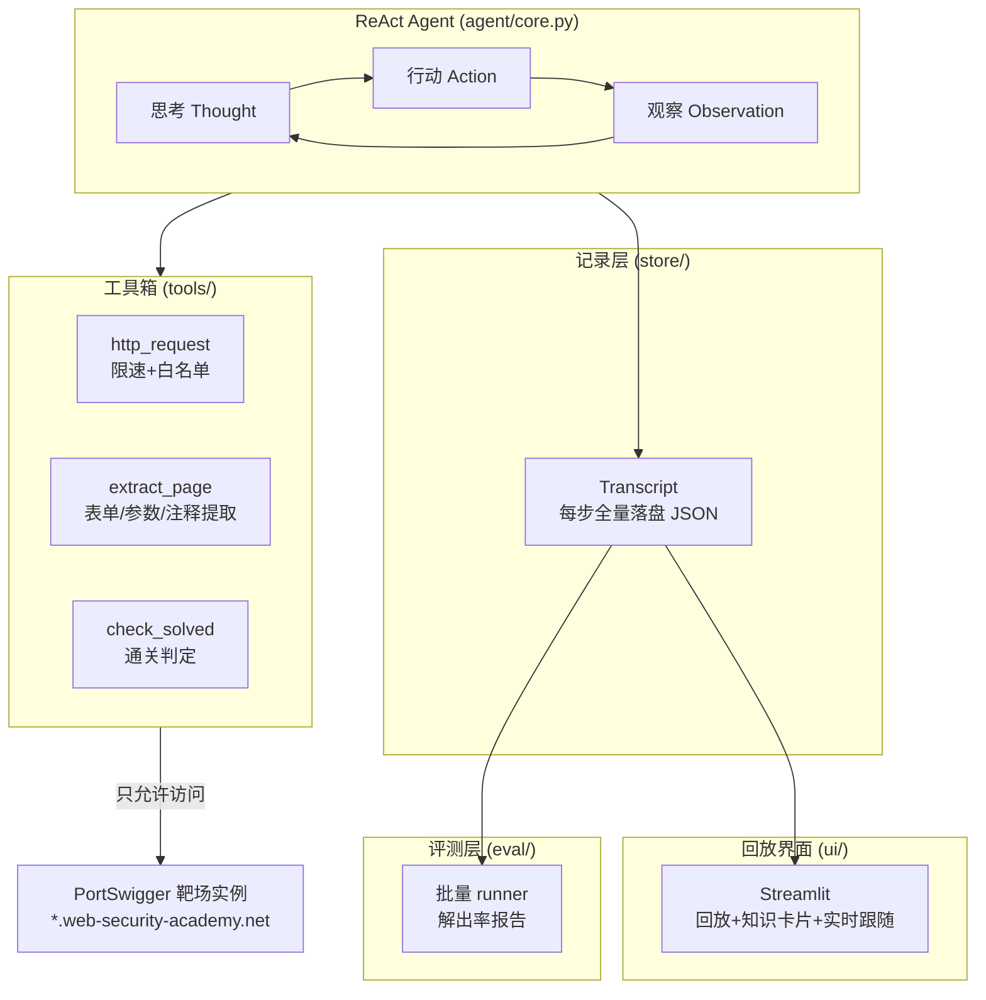

# WebSec Lab Agent 🛡️

**一个针对 PortSwigger Web Security Academy 靶场的 LLM 渗透测试 Agent，带完整的运行回放与知识点可视化。**

LLM 作为「渗透测试大脑」自主规划测试路径：侦察页面 → 定位注入点 → 生成 payload → 观察响应 → 调整策略 → 通关靶场。每一步的思考、HTTP 报文、观察结果全部落盘，可在回放界面逐步复盘学习。

> ⚠️ **合规声明**：本项目仅用于**已授权**的教学场景（PortSwigger 官方靶场 / 本地 mock 靶场）。靶场 HTTP 客户端逐次检查目标域名白名单（包括重定向），并实施请求限速和数量上限。白名单不是测试授权，请勿用于任何未授权测试。

---

## 功能特性

- **手写 ReAct 循环**（~100 行核心，无重量级框架）：`思考 → 行动 → 观察`，方便讲清原理、按需改造
- **工具箱**：`http_request` / `extract_page`（表单、链接、参数、HTML 注释提取）/ `check_solved`（自动通关判定）/ `note`
- **安全设计**：每一跳 HTTP(S) 请求（含重定向）都检查域名白名单、限速和单次运行请求数上限；循环跳转仍受重定向次数限制
- **12 道经典题注册表**：SQL 注入、XSS、路径穿越、越权、信息泄露，全部单机可解（无需 Burp Collaborator）
- **双模式实验**：`hint`（告知漏洞类型） vs `blind`（盲测，自行侦察判断）——对比解出率就是项目的核心实验
- **评测报告**：批量跑题自动汇总解出率 / 步数 / 请求数 / LLM 调用 / 耗时，输出 Markdown + CSV
- **回放界面**（Streamlit）：每步展示「页面快照 → 思考 → 请求 → 响应」，附漏洞知识卡片，支持运行中实时跟随
- **LLM 无关**：OpenAI / 智谱 GLM / DeepSeek / Qwen / 本地 Ollama，改一行配置即可切换

## 架构



## 快速开始

### 0. 安装

```bash
python3 -m venv .venv
source .venv/bin/activate      # Windows: .venv\Scripts\activate
pip install -r requirements.txt
```

### 1. 30 秒体验（不需要任何 API key 和账号）

内置一个「SQL 注入登录绕过」mock 靶场 + 剧本模式的 LLM，端到端验证整条链路：

```bash
python main.py smoke
```

跑完会生成 `runs/*.json` 运行记录，然后打开回放界面查看：

```bash
python main.py ui
```

### 2. 配置 LLM

```bash
cp config.example.yaml config.yaml
# 编辑 config.yaml：填 base_url / api_key / model
#   OpenAI:    https://api.openai.com/v1
#   智谱 GLM:  https://open.bigmodel.cn/api/paas/v4
#   DeepSeek:  https://api.deepseek.com/v1
#   Ollama:    http://localhost:11434/v1 （本地免费）
# api_key 也可用环境变量传入: export LLM_API_KEY=sk-xxx
```

### 3. 打真实靶场

1. 注册/登录 [PortSwigger Web Security Academy](https://portswigger.net/web-security)（免费），进入某个题目页点击 **Launch lab**
2. 复制实例地址（形如 `https://0a2b008f03xxxx.web-security-academy.net`）
3. 运行：

```bash
# 提示模式（告知漏洞类型）
python main.py run --lab sqli_login_bypass --url https://xxxx.web-security-academy.net

# 盲测模式（只给 URL，自行侦察判断漏洞类型）
python main.py run --lab sqli_login_bypass --url https://xxxx.web-security-academy.net --blind

# 查看回放
python main.py ui
```

### 4. 批量评测（出实验数据）

把 12 道题的实例地址依次填入 `labs/registry.yaml` 的 `lab_url` 字段（注意实例约 1 小时闲置会过期，失效就重新 Launch），然后：

```bash
python main.py eval --mode hint
python main.py eval --mode blind
# 对比 runs/eval-hint-*.md 与 runs/eval-blind-*.md 即得核心实验结论
```

## 命令一览

| 命令 | 说明 |
|---|---|
| `python main.py labs` | 查看题目清单与就绪状态 |
| `python main.py smoke` | 本地冒烟测试（无需 API/账号） |
| `python main.py run --lab <id> --url <addr>` | 对单个靶场运行 Agent |
| `python main.py run ... --blind` | 盲测模式 |
| `python main.py eval --mode hint\|blind` | 批量评测并生成报告 |
| `python main.py ui` | 启动 Streamlit 回放界面 |

## 开发验证

安装依赖后，可运行不需要 API key 或真实靶场的回归测试：

```bash
python -m unittest discover -s tests -p "test_*.py" -v
python main.py smoke
```

HTTP 客户端回归使用内存适配器，不发出网络请求，覆盖越界重定向拦截、逐跳请求预算和限速、循环跳转、方法/请求体及凭据处理。冒烟测试仅访问本地 `127.0.0.1:5050`。

GitHub Actions 使用 Python 3.12，在 Ubuntu 和 Windows 上执行上述检查，不需要任何模型密钥或外部靶场账号。

请求预算与 HTTP 请求指标按实际尝试发送的次数计数，重定向每一跳各计一次；发送前被白名单拦截的目标不计入。`SafeHTTP.traffic` 保留每一跳的报文，现有工具观察和回放步骤仍展示该次工具调用的最后一条流量。此检查基于 URL 域名，不等同于 DNS/IP 隔离沙箱，也不替代靶场授权。

## 回放界面

每一步四要素：**看到什么（页面快照）→ 想什么（思考）→ 做什么（请求）→ 得到什么（响应）**，原始 HTTP 报文可展开查看；页面底部附当前漏洞类别的知识卡片（原理 / 常用 payload / 防御建议）。

运行中在侧边栏勾选「实时跟随」即可直播 Agent 干活；配合 Burp 的 HTTP history（把 Agent 流量代理到 Burp）可以同时看到两层视角。

## 实验设计（怎么让项目"像研究"）

| 对比 | 结论指向 |
|---|---|
| hint 模式 vs blind 模式 | LLM 需要多少先验知识才能完成自主渗透 |
| 字典 fuzz 基线 vs Agent | LLM 的"理解页面"是否带来更高的解出率/更少的请求 |
| 带 vs 不带跨题记忆（Roadmap） | 经验积累对同类漏洞的作用 |

## 目录结构

```
websec-lab-agent/
├── main.py               # CLI 入口（run / eval / ui / labs / smoke）
├── config.example.yaml   # 配置模板（LLM / 限速 / 白名单）
├── agent/
│   ├── core.py           # ReAct 循环核心
│   ├── llm.py            # OpenAI 兼容客户端（含 Ollama）+ 冒烟用 ScriptedLLM
│   └── prompts.py        # 系统提示词 / 任务构造（hint 与 blind）
├── tools/
│   ├── http_client.py    # 白名单 + 限速 + 原始报文捕获
│   ├── recon.py          # 表单/链接/参数/注释提取
│   └── builtin_tools.py  # 工具注册与调度
├── store/transcript.py   # 运行记录落盘
├── labs/registry.yaml    # 12 道 PortSwigger 题注册表
├── docs/knowledge.yaml   # 漏洞类别 → 知识卡片
├── eval/runner.py        # 批量评测与报告
├── ui/app.py             # Streamlit 回放界面
└── tests/
    ├── mock_lab.py       # 本地 mock 靶场（SQLi 登录绕过）
    └── smoke_test.py     # 端到端冒烟测试
```

## 开发测试

安装依赖后，运行离线 CLI 回归测试：

```bash
python -m unittest discover -s tests -v
```

测试覆盖评测入口的默认模式、盲测模式、题目筛选、自定义配置路径和无可运行题目时的提示，不调用 LLM API 或远程靶场。完整的本地 mock 冒烟测试仍使用 `python main.py smoke`。

## Roadmap

- [ ] 跨题记忆：解完一题总结经验，带入下一题（对比解出率提升）
- [ ] 盲测模式下的漏洞类型自动归类输出
- [ ] CSRF 类题目：自动化操作题内 Exploit Server
- [ ] Playwright 截图版页面快照（回放界面显示真实渲染效果）
- [ ] 字典 fuzz 基线脚本（与 Agent 对比）

## License

MIT
